# TP5DPBO2526C2 PeopleData – Rumah Sakit Psikologi

Saya Moch Fadillah Pratama dengan NIM 2506968 mengerjakan Tugas Praktikum 5 dalam mata kuliah Desain Pemrograman Berorientasi Objek untuk keberkahan-Nya maka saya tidak akan melakukan kecurangan seperti yang telah dispesifikasikan. Aamiin.

Aplikasi desktop berbasis **Java Swing** untuk mengelola data pasien dan tenaga di sebuah Rumah Sakit Psikologi. Proyek ini adalah lanjutan TP 4 dan dikerjakan sebagai **Tugas Praktikum 5 – Java Swing GUI: Database dan Back-End** pada mata kuliah **Desain dan Pemrograman Berorientasi Objek (DPBO)**.

Pada TP 4 data disimpan sementara di `ArrayList`. Pada TP 5 seluruh data disimpan di **database MySQL (`db_people`)** lewat **JDBC**, sehingga data tetap ada walaupun aplikasi ditutup. Seluruh operasi **CRUD** (Create, Read, Update, Delete) terhubung langsung ke database, dilengkapi **konfirmasi sebelum hapus** dan **validasi input**.

---

## Struktur Folder

```
TP5DPBO2526C2/                 <- repository GitHub (public)
├── PeopleData/                <- folder project (IntelliJ)
│   ├── Database.java
│   ├── Person.java
│   ├── PeopleMenu.java
│   └── PeopleMenu.form
├── Dokumentasi/               <- video dokumentasi program berjalan
├── db_people.sql              <- skrip database (tabel + data awal)
└── README.md
```
## Desain Program

### Tampilan (GUI)

Tampilan tidak berubah dari TP 4. Layout utama `mainPanel` memakai **GridLayoutManager** (4 baris × 1 kolom):

| Baris | Komponen           | Keterangan                                                             |
| ----- | ------------------ | ---------------------------------------------------------------------- |
| 0     | `JLabel`           | Judul: "Data Pasien dan Tenaga Rumah Sakit Psikologi"                  |
| 1     | `formPanel`        | Panel isian (5 baris × 2 kolom): ID, Nama, Tahun Lahir, Kategori, MBTI |
| 2     | `buttonPanel`      | Panel tombol (1 baris × 3 kolom): Add/Update, Delete, Cancel           |
| 3     | `peopleScrollPane` | Pembungkus `peopleTable` agar bisa di-scroll                           |

### Field name komponen (harus sama dengan variabel di Java)

| Field name         | Tipe                | Fungsi                                                             |
| ------------------ | ------------------- | ------------------------------------------------------------------ |
| `mainPanel`        | `JPanel`            | Panel root, dipasang ke `JFrame`                                   |
| `formPanel`        | `JPanel`            | Penampung label dan isian                                          |
| `idField`          | `JTextField`        | Isian ID                                                           |
| `namaField`        | `JTextField`        | Isian Nama                                                         |
| `tahunLahirField`  | `JTextField`        | Isian Tahun Lahir                                                  |
| `kategoriComboBox` | `JComboBox<String>` | Dropdown Kategori (Pasien, Psikolog, Psikiater, Perawat, Konselor) |
| `mbtiComboBox`     | `JComboBox<String>` | Dropdown MBTI (16 tipe)                                            |
| `buttonPanel`      | `JPanel`            | Penampung tombol                                                   |
| `addUpdateButton`  | `JButton`           | Tombol dua fungsi: Add / Update                                    |
| `deleteButton`     | `JButton`           | Tombol Delete (tampil hanya saat ada baris terpilih)               |
| `cancelButton`     | `JButton`           | Tombol Cancel                                                      |
| `peopleScrollPane` | `JScrollPane`       | Pembungkus tabel                                                   |
| `peopleTable`      | `JTable`            | Tabel data (No, ID, Nama, Tahun Lahir, Kategori, MBTI)             |

## Desain Database

Database: **`db_people`**, tabel: **`person`**. Skrip lengkap ada di [`db_people.sql`](db_people.sql).

| Kolom       | Tipe           | Keterangan                                  |
| ----------- | -------------- | ------------------------------------------- |
| `id`        | `VARCHAR(10)`  | **Primary key**, contoh: `P001`             |
| `nama`      | `VARCHAR(100)` | Nama lengkap                                |
| `thn_lahir` | `INT`          | Tahun lahir                                 |
| `kategori`  | `VARCHAR(20)`  | Pasien, Psikolog, Psikiater, Perawat, Konselor |
| `mbti`      | `VARCHAR(4)`   | Tipe kepribadian MBTI, contoh: `INFJ`       |

Data awal (sama dengan data awal TP 4):

| ID   | Nama             | Tahun Lahir | Kategori  | MBTI |
| ---- | ---------------- | ----------- | --------- | ---- |
| P001 | Rina Amelia      | 1998        | Pasien    | INFJ |
| P002 | Dr. Budi Santoso | 1980        | Psikiater | INTJ |
| P003 | Sinta Maharani   | 1990        | Psikolog  | ENFP |
| P004 | Andi Pratama     | 2001        | Pasien    | ISTP |
| P005 | Lestari Dewi     | 1993        | Perawat   | ISFJ |
| P006 | Fajar Nugroho    | 1987        | Konselor  | ENFJ |

## Penjelasan Class

### `Person`

Class model (*blueprint*) untuk satu data orang. Tidak berubah dari TP 4. Atribut: `id`, `nama`, `tahunLahir`, `kategori`, `mbti`, semuanya `private` dan diakses lewat getter/setter. Pada TP 5 class ini dipakai sebagai pembawa data hasil validasi sebelum disimpan ke database, **bukan** lagi sebagai isi `ArrayList`.

### `Database` (baru)

Class penghubung aplikasi dengan MySQL lewat JDBC.

| Method                          | Fungsi                                                                   |
| ------------------------------- | ------------------------------------------------------------------------ |
| `Database()`                    | Konstruktor: membuka koneksi ke `jdbc:mysql://localhost:3306/db_people` dan membuat `Statement` |
| `selectQuery(String)`           | Menjalankan `SELECT`, mengembalikan `ResultSet`                          |
| `insertUpdateDeleteQuery(String)` | Menjalankan `INSERT`/`UPDATE`/`DELETE`, mengembalikan jumlah baris terpengaruh |
| `getStatement()`                | Getter untuk `Statement`                                                 |

### `PeopleMenu`

| Method                        | Fungsi                                                                              |
| ----------------------------- | ----------------------------------------------------------------------------------- |
| `PeopleMenu()`                | Konstruktor: membuka koneksi database, mengisi tabel dan dropdown, memasang listener |
| `setTable()`                  | Mengambil semua data dari tabel `person` dan mengembalikannya sebagai `DefaultTableModel` untuk `JTable` (**Read**) |
| `insertData()`                | Menyimpan data baru dengan `INSERT` (**Create**)                                    |
| `updateData()`                | Mengubah data terpilih dengan `UPDATE` (**Update**)                                 |
| `deleteData()`                | Menghapus data terpilih dengan `DELETE` setelah konfirmasi (**Delete**)             |
| `clearForm()`                 | Reset form dan kembali ke mode *Add*                                                |
| `readAndValidate(String)`     | Membaca form, memvalidasi, mengembalikan `Person` atau `null`                       |
| `isIdExists(String, String)`  | Mengecek ke database apakah ID sudah dipakai (`SELECT COUNT(*)`)                    |
| `escape(String)`              | Meng-escape tanda petik pada teks agar aman dimasukkan ke query SQL                 |
| `showError(String)`           | Helper dialog error                                                                 |
| `main(String[])`              | Titik awal program, membungkus `mainPanel` ke `JFrame`                              |

Atribut tambahan: `database` (objek `Database`) dan `selectedIndex` (`int`, `-1` berarti belum ada baris terpilih).

## Alur Program

### 1. Saat program dijalankan

1. `main()` membuat `JFrame` dan objek `PeopleMenu`.
2. Konstruktor membuat objek `Database`, yang membuka koneksi ke MySQL `db_people`.
3. `setTable()` menjalankan `SELECT * FROM person ORDER BY id` lalu mengisi `JTable`.
4. Dropdown Kategori dan MBTI diisi, tombol *Delete* disembunyikan, dan semua listener dipasang.
5. `mainPanel` dipasang ke `JFrame` lalu window ditampilkan di tengah layar.

### 2. Create (tambah data)

1. Pengguna mengisi form dan menekan **Add** (`selectedIndex == -1`).
2. `insertData()` memanggil `readAndValidate("")`.
3. Jika ada kolom kosong atau ID sudah ada di database, dialog error tampil dan proses dibatalkan.
4. Jika valid, query `INSERT INTO person ...` dijalankan, tabel di-refresh (`setTable()`), form dikosongkan (`clearForm()`), dan muncul pesan sukses.

### 3. Read (tampil data)

1. `setTable()` menjalankan query `SELECT` lewat `database.selectQuery()`.
2. Setiap baris `ResultSet` dimasukkan ke `DefaultTableModel`, lalu model dipasang ke `peopleTable`.
3. Method ini dipanggil setiap data berubah agar tampilan selalu sinkron dengan database.

### 4. Update (ubah data)

1. Pengguna mengklik baris tabel. Nilai tiap kolom diambil dengan `peopleTable.getValueAt(...)` (tanpa `ArrayList`) dan ditampilkan di form. Tombol berubah menjadi **Update** dan tombol **Delete** muncul.
2. Pengguna mengubah isian lalu menekan **Update** (`selectedIndex != -1`).
3. `updateData()` mengambil ID lama dari tabel, lalu memanggil `readAndValidate(idLama)`. ID lama dikecualikan dari cek duplikat.
4. Jika valid, query `UPDATE person SET ... WHERE id = <ID lama>` dijalankan, tabel di-refresh, form di-reset, dan muncul pesan sukses.

### 5. Delete (hapus data)

1. Pengguna memilih baris lalu menekan **Delete**.
2. `deleteData()` mengambil ID dan Nama dari tabel dan menampilkan dialog konfirmasi.
3. Jika memilih **Yes**: query `DELETE FROM person WHERE id = ...` dijalankan, tabel di-refresh, form di-reset, dan muncul pesan sukses.
4. Jika memilih **No** atau menutup dialog: data tetap aman.

### 6. Cancel

`clearForm()` mengosongkan semua isian, mengembalikan dropdown ke item pertama, mengubah tombol menjadi *Add*, menyembunyikan *Delete*, mereset `selectedIndex = -1`, dan menghapus sorotan baris tabel.

## Validasi & Error Handling

Semua error memakai `JOptionPane.showMessageDialog(..., JOptionPane.ERROR_MESSAGE)`.

| No | Validasi                                                    | Pesan                                                    |
| -- | ----------------------------------------------------------- | -------------------------------------------------------- |
| 1  | ID kosong (insert/update)                                   | `ID tidak boleh kosong!`                                 |
| 2  | Nama kosong (insert/update)                                 | `Nama tidak boleh kosong!`                               |
| 3  | Tahun Lahir kosong (insert/update)                          | `Tahun Lahir tidak boleh kosong!`                        |
| 3a | Kategori belum dipilih (masih `-- Pilih Kategori --`)       | `Kategori belum dipilih!`                                |
| 3b | MBTI belum dipilih (masih `-- Pilih MBTI --`)               | `MBTI belum dipilih!`                                    |
| 4  | ID sudah ada di database                                    | `ID "..." sudah digunakan! Gunakan ID yang berbeda.`     |
| 5  | Tahun Lahir bukan angka (`try-catch NumberFormatException`) | `Tahun Lahir harus berupa angka! Contoh: 1998`           |
| 6  | Tahun Lahir di luar 1900 – tahun sekarang                   | `Tahun Lahir harus di antara 1900 dan <tahun sekarang>!` |
| 7  | Delete tanpa memilih data                                   | `Pilih data yang ingin dihapus terlebih dahulu!`         |

## Cara Menjalankan

**Prasyarat**: JDK 8+ (disarankan 17+), IntelliJ IDEA, MySQL (Laragon/XAMPP), dan MySQL Connector/J.

1. Clone repository ini.
2. Nyalakan MySQL (Laragon: **Start All**).
3. Impor `db_people.sql` ke MySQL (HeidiSQL: **File → Load SQL file…** lalu **Execute**, atau lewat phpMyAdmin tab **SQL**/**Import**).
4. Buka folder `PeopleData` sebagai project di IntelliJ IDEA.
5. Pastikan file `mysql-connector-j-xxx.jar` ada di folder `lib` dan terdaftar di **Project Structure → Modules → Dependencies**.
6. Pastikan GUI Designer aktif: **Settings → Editor → GUI Designer → Generate GUI into: Java source code**.
7. Jika perlu, sesuaikan URL, username, dan password di konstruktor `Database` (default: `localhost:3306`, `root`, tanpa password).
8. Buka `PeopleMenu.java`, klik ikon ▶ di samping `main()`, lalu pilih **Run 'PeopleMenu.main()'**.

> Jika muncul `Cannot bind: field does not exist`, pastikan nama variabel di Java sama persis dengan *field name* di `PeopleMenu.form`.
> Jika muncul `Communications link failure`, pastikan MySQL sudah menyala dan port-nya sesuai.

## Dokumentasi Program Berjalan

> Berkas dokumentasi disimpan di folder `Dokumentasi/`.

### 1. Tampilan awal (Read dari database)

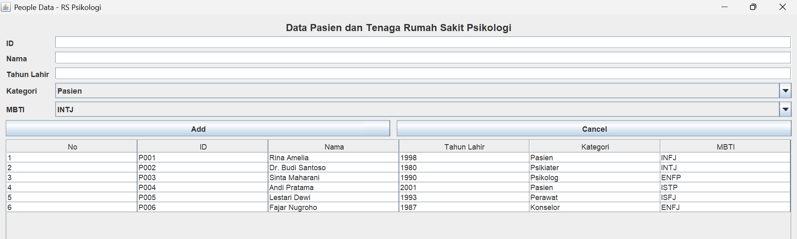

### 2. Create – menambah data

#### Mengisi data

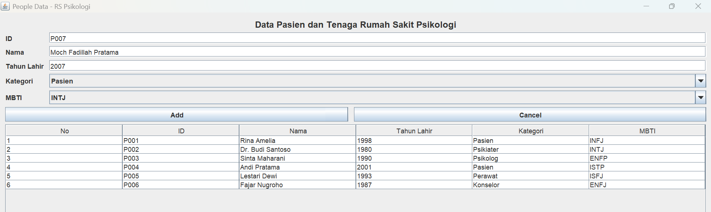

#### Data berhasil ditambahkan

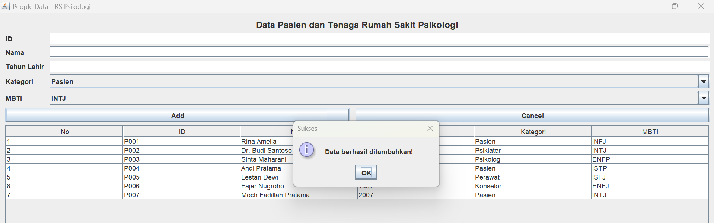

#### Tabel setelah ditambahkan

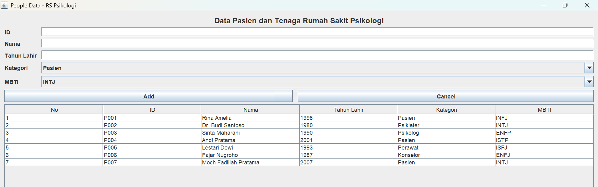

#### Data tersimpan di database (HeidiSQL)

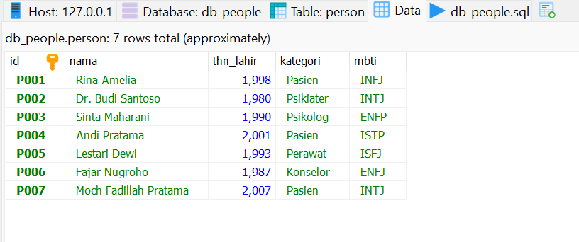

### 3. Update – mengubah data

#### Memilih data

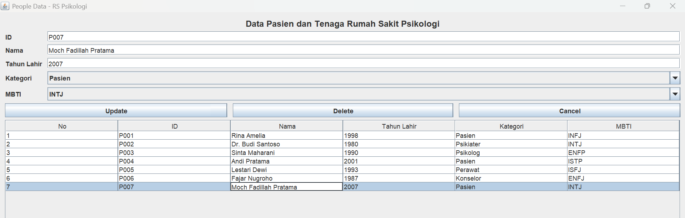

#### Mengubah isi data

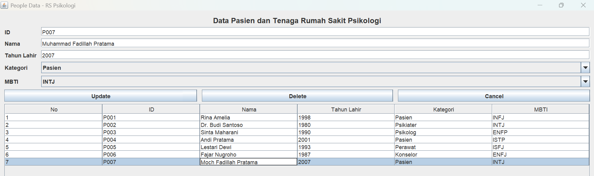

#### Data berhasil diubah

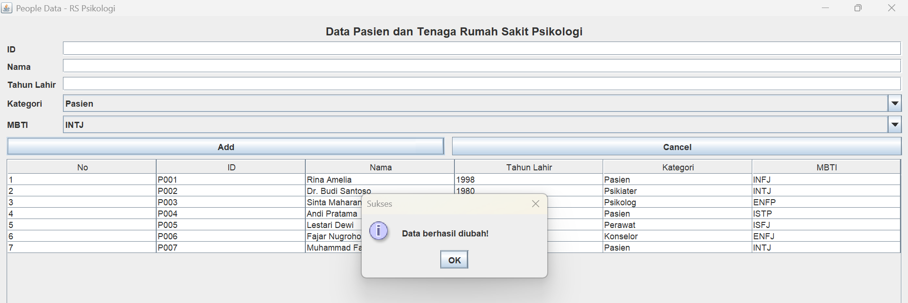

#### Tabel setelah diubah

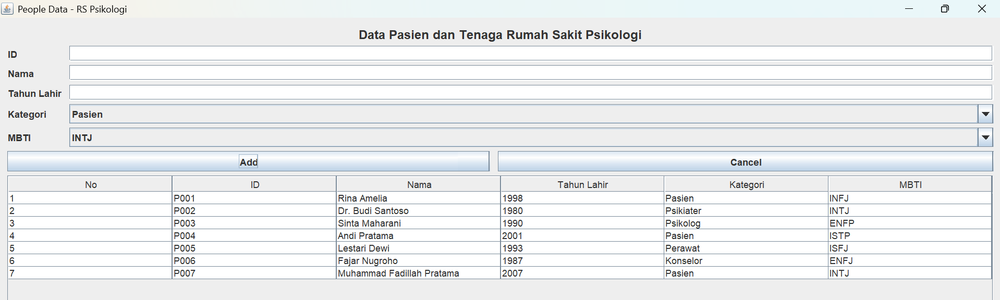

#### Data berubah di database (HeidiSQL)

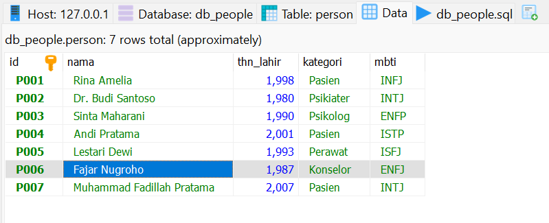

### 4. Delete – menghapus data (dengan konfirmasi)

#### Memilih data

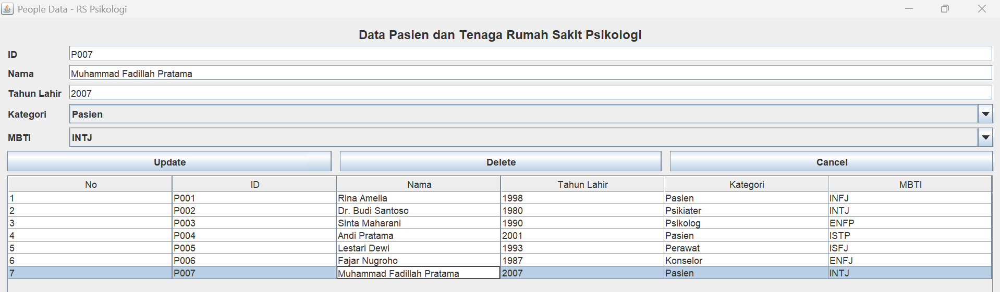

#### Mengonfirmasi penghapusan data

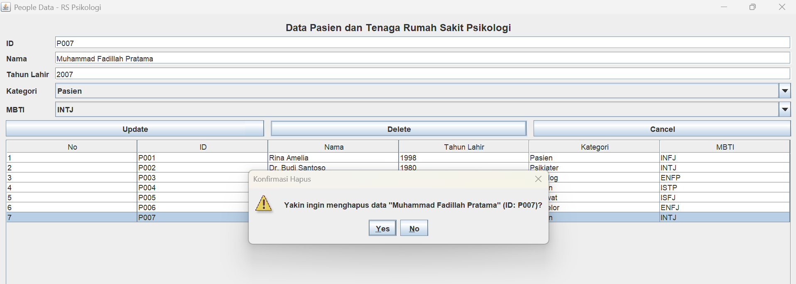

#### Data berhasil dihapus

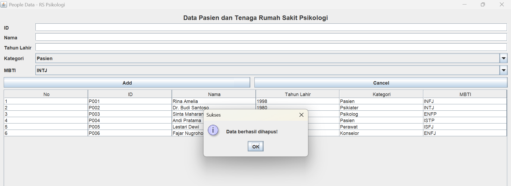

#### Tabel setelah dihapus

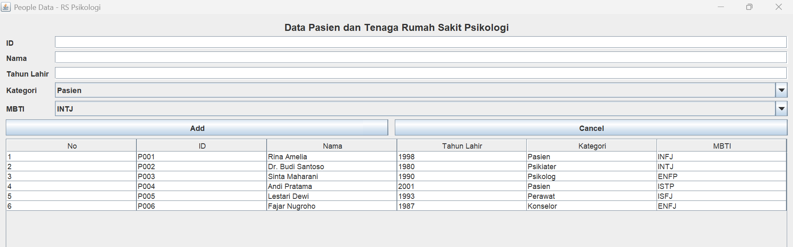

#### Data hilang dari database (HeidiSQL)

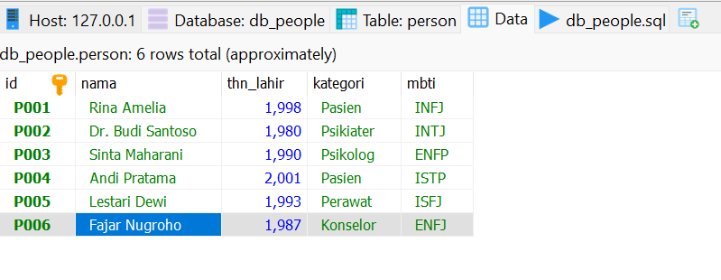

### 5. Validasi input / error handling

#### 5.1 Insert: ID kosong
 
Pesan: `ID tidak boleh kosong!`
 
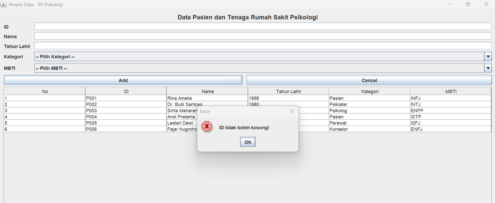
 
#### 5.2 Insert: Nama kosong
 
Pesan: `Nama tidak boleh kosong!`
 
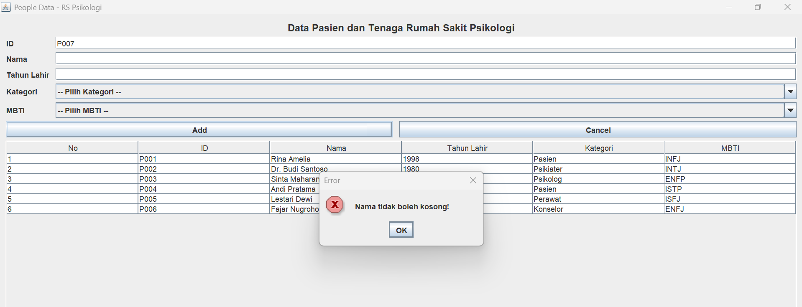
 
#### 5.3 Insert: Tahun Lahir kosong
 
Pesan: `Tahun Lahir tidak boleh kosong!`
 
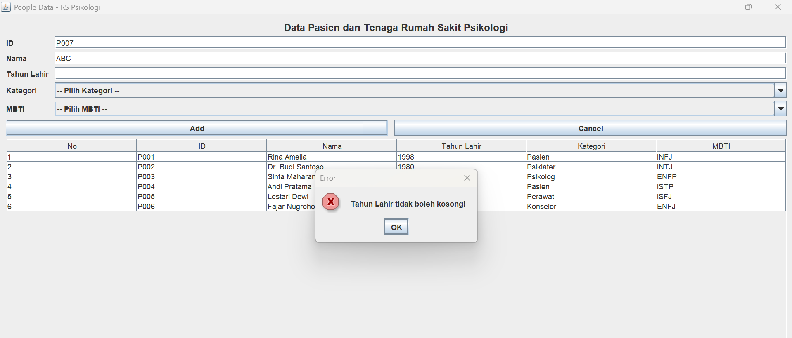
 
#### 5.4 Insert: Kategori belum dipilih
 
Pesan: `Kategori belum dipilih!`
 
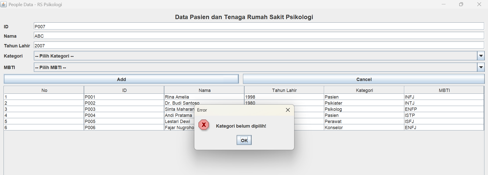
 
#### 5.5 Insert: MBTI belum dipilih
 
Pesan: `MBTI belum dipilih!`
 
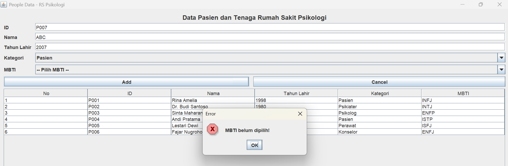
 
#### 5.6 Update: kolom dikosongkan
 
Memilih satu baris, mengosongkan kolom, lalu menekan Update
 
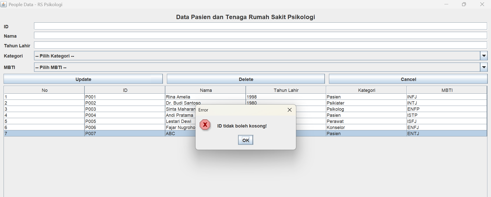
 
#### 5.7 Insert: ID sudah ada
 
Pesan: `ID "..." sudah digunakan! Gunakan ID yang berbeda.`
 
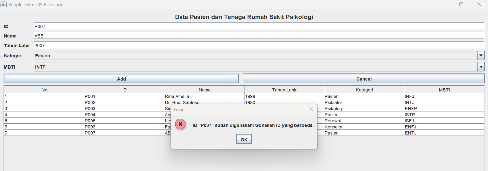
 
#### 5.8 Insert: Tahun Lahir berupa huruf
 
Pesan: `Tahun Lahir harus berupa angka! Contoh: 1998`
 
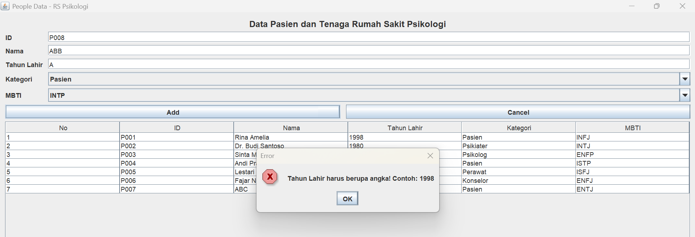
 
#### 5.09 Insert: Tahun Lahir lebih dari tahun sekarang (2026)
 
Pesan: `Tahun Lahir harus di antara 1900 dan 2026!`
 
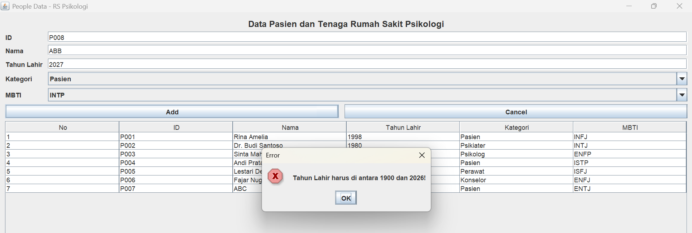
## Perubahan dari TP 4

| Aspek               | TP 4                              | TP 5                                                          |
| ------------------- | --------------------------------- | ------------------------------------------------------------- |
| Penyimpanan data    | `ArrayList<Person>` (sementara)   | Database MySQL `db_people` (permanen)                         |
| Koneksi             | –                                 | Class `Database` (JDBC)                                       |
| Data awal           | `populateList()`                  | `db_people.sql`                                               |
| Read                | Loop `personList`                 | `SELECT` + `ResultSet`                                        |
| Ambil data terpilih | `personList.get(selectedIndex)`   | `peopleTable.getValueAt(selectedIndex, kolom)`                |
| Cek ID ganda        | Loop `personList`                 | `SELECT COUNT(*)` ke database                                 |
| Create/Update/Delete| Ubah isi `ArrayList`              | `INSERT` / `UPDATE` / `DELETE`                                |
